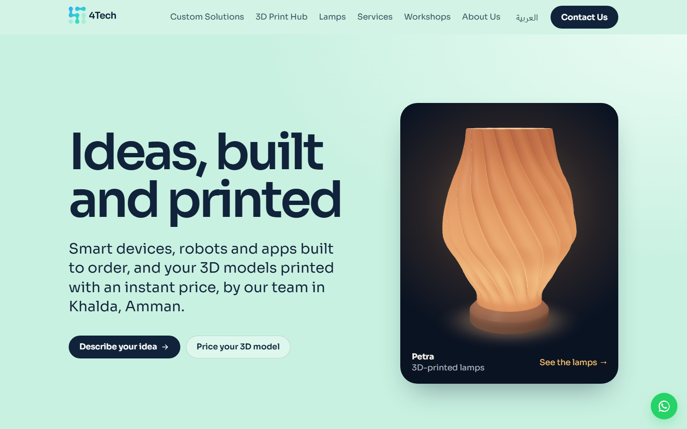
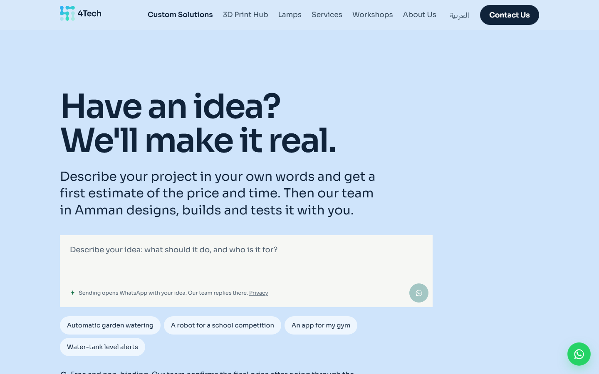
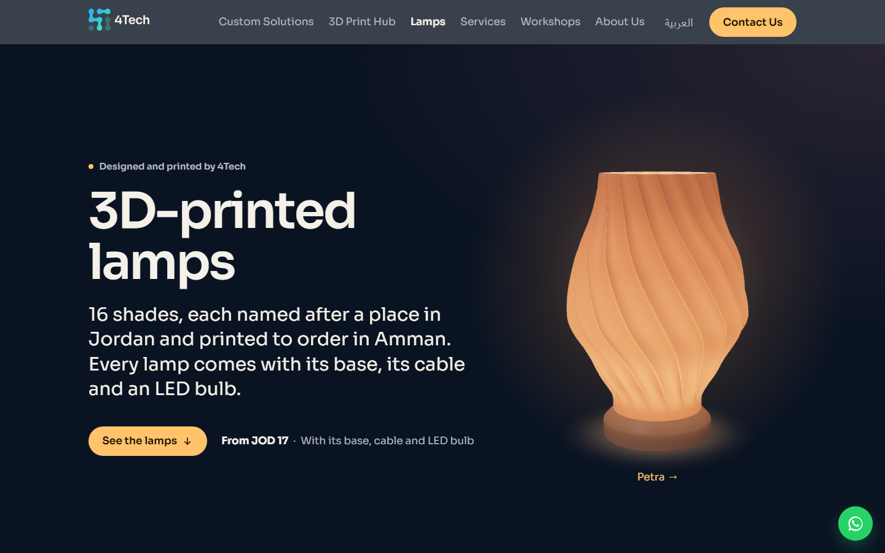
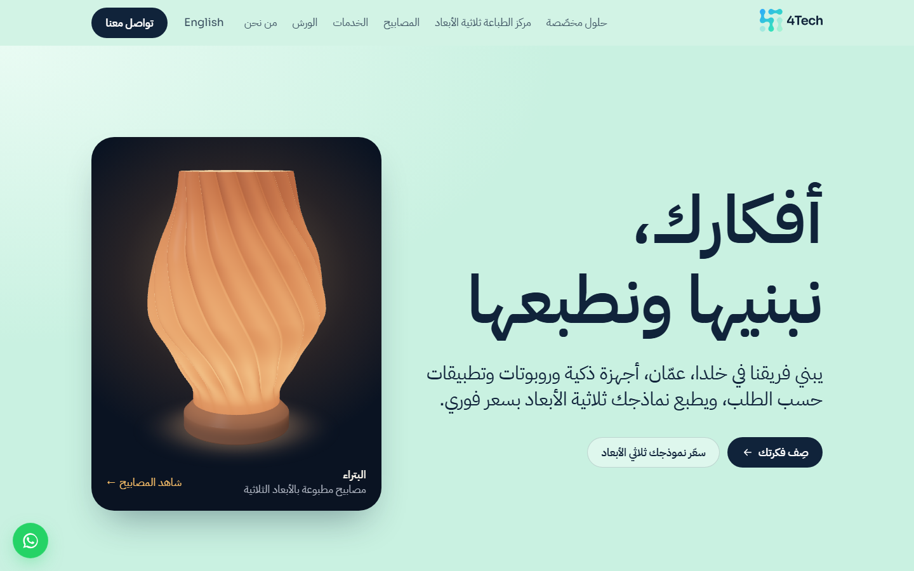
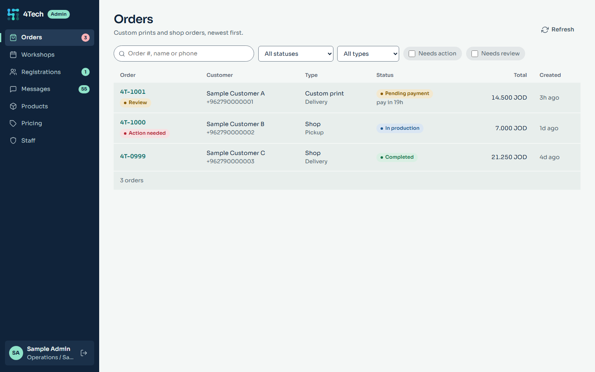
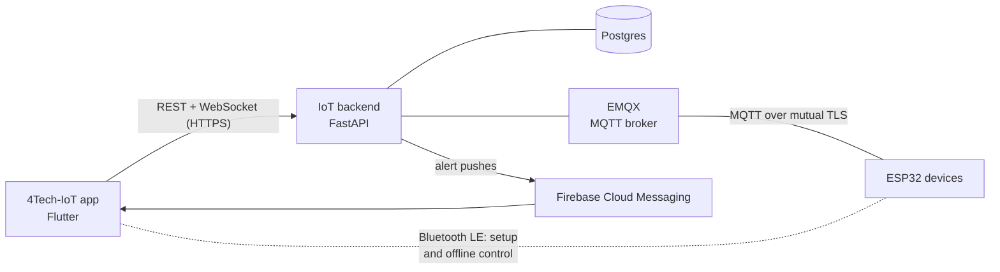
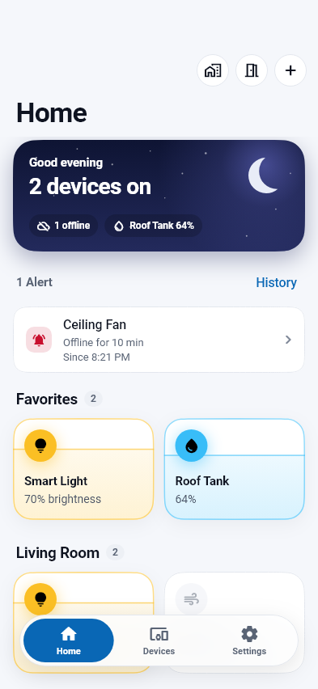
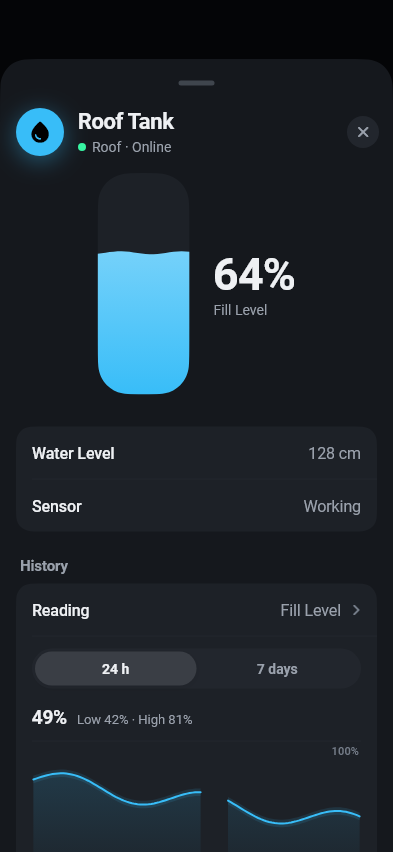
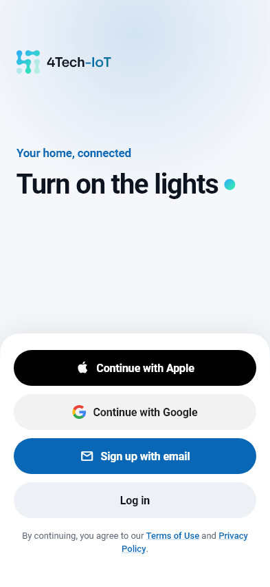
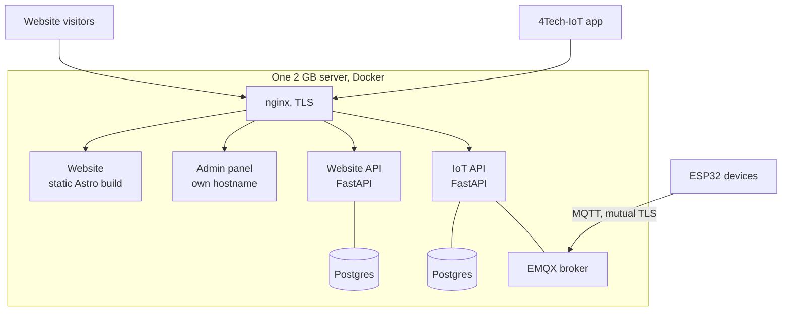

  

# My work at 4Tech

I'm Nizar. This repository shows what I built for [4Tech](https://4thtechjo.com), a company
in Amman, Jordan that teaches electronics and robotics, builds custom smart devices and runs a
3D printing service.

Between August and November 2026 I built three things for them:

| | Project | What it is | Built with |
|---|---|---|---|
| 1 | [The website](projects/website.md) | Bilingual company site with instant 3D-print pricing, an AI assistant that makes first price offers, a product line of lamps drawn live in 3D, and a staff admin panel | Astro, FastAPI, Postgres, Docker, nginx |
| 2 | [The 4Tech-IoT app](projects/iot-app.md) | One phone app for every 4Tech smart-home device, plus the firmware the devices run | Flutter, ESP32 (C++), Bluetooth LE |
| 3 | [The IoT backend](projects/iot-backend.md) | The self-hosted server behind the app: accounts, devices, live updates, alerts, firmware updates | FastAPI, EMQX (MQTT), Postgres, Docker |

And the part I'd point a reviewer to first: [**problems I solved**](problems-solved.md), with
the cause and the fix for each.

> The source code belongs to 4Tech and lives in private repositories. This repository holds
> descriptions, diagrams and screenshots, not the code itself.

## The website

Live at **[4thtechjo.com](https://4thtechjo.com)**, in English and Arabic.

| Custom Solutions: the AI assistant | The lamps, drawn in the browser |
|---|---|
|  |  |

| Arabic, right to left | The staff admin panel (sample data) |
|---|---|
|  |  |

[More about the website →](projects/website.md)

## The 4Tech-IoT platform

The app, the firmware and the backend are one system. A device's firmware describes the
device (its controls, readings and settings) in a **schema**, and the app builds the screen
from that. The app has no code for any particular product, so a new product needs only new
firmware.

| Home | A water tank | Sign-in |
|---|---|---|
|  |  |  |

- Set a device up over Bluetooth; its Wi-Fi password travels encrypted.
- Control it from anywhere through the server, or directly over Bluetooth when the internet
  is down.
- Share a home, farm or shop with other people through invite codes.
- Get a push notification when a tank runs low or a device goes offline.
- Update device firmware over the air; devices install only signed releases.

[More about the app →](projects/iot-app.md) · [More about the backend →](projects/iot-backend.md)

## How it all runs

Everything runs on one small cloud server (1 vCPU, 2 GB of RAM), in Docker. Every container
has a memory limit, and the website is static files behind nginx so it costs almost nothing
to serve.

## A few of the problems

The full list, with causes and fixes, is in [problems-solved.md](problems-solved.md).

| Problem | What I did |
|---|---|
| The MQTT broker was accepting anonymous connections, and the code meant to lock it was failing silently | Mutual TLS with a certificate per device, deny by default, and a setup check that fails loudly |
| An unplugged device still showed as online for up to two minutes | Shorter keepalive on both ends: offline within about 30 seconds |
| The app could not connect from iPhones at all | iOS rejects server certificates valid for more than 825 days; reissued in place, with no change to devices in the field |
| The ESP32 ran out of memory when Bluetooth, Wi-Fi and TLS ran together | Switched the Bluetooth stack and the partition layout |
| One visitor could lock everyone out of the contact form, and lock staff out of sign-in | Rate limits were counting the proxy's address, not the visitor's |
| Orders failed on the real database while every test passed | A Postgres sequence that SQLite never needed |
| A deploy could leave the site broken | A deploy script that backs up, tests the new version and rolls back by itself |

## Skills this shows

- **Backend:** Python, FastAPI, async SQLAlchemy, Postgres, Alembic migrations, WebSockets,
  server-sent events, background workers, rate limiting, role-based access.
- **Mobile:** Flutter and Dart, Riverpod, Bluetooth LE, push notifications, Sign in with
  Apple and Google, release builds for both stores through CI.
- **Embedded:** ESP32 firmware in C++, MQTT, TLS on a microcontroller, signed over-the-air
  updates with rollback, NRF24 radio links.
- **Frontend:** Astro, TypeScript, Tailwind, WebGL without a library, English and Arabic
  (right to left), accessibility and performance work.
- **Security:** mutual TLS, a private certificate authority, keys that never leave the
  device, Argon2 passwords, server-side sessions, CSRF protection.
- **Operations:** Docker Compose, nginx, Let's Encrypt, backups, a self-checking deploy,
  Prometheus, running a whole platform inside 2 GB.
- **AI:** a Claude-based assistant that makes price offers through a checked tool call, with
  prompt caching and spending limits.

## Contact

Nizar · [github.com/notnizar](https://github.com/notnizar)
