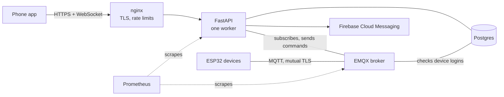

# The IoT backend

[← Back to the overview](../README.md)

**Built:** September 2026 · **My part:** everything (API, broker setup, security, deployment)

The self-hosted server behind the [4Tech-IoT app](iot-app.md). Phones talk to it over HTTPS
and a WebSocket. Devices talk to it over MQTT. It keeps the accounts, the devices and their
state, checks alert rules, sends push notifications and hands out firmware updates.

## Architecture

| Part | Role |
|---|---|
| FastAPI | REST API, the WebSocket for live events, and the background workers |
| EMQX 5.8 | MQTT broker for devices; checks logins and permissions against Postgres |
| Postgres | Accounts, sites, devices, state, history, alert rules, firmware releases |
| nginx | TLS, rate limiting, security headers |
| Prometheus | Metrics from the API and the broker |

Everything is in Docker Compose, with a production file that sets a memory limit for each
container.

## What it does

- **Accounts.** Email and password, Sign in with Google and with Apple (the server checks
  each provider's token against its published keys), password reset by emailed code, and
  account deletion.
- **Sessions that can be revoked one phone at a time.** Signing out ends that phone's
  session and leaves the account's other phones alone.
- **Claiming a device.** The app passes on the device's certificate signing request; the
  server certifies the device's own key and returns what the device needs to connect. No
  private key is ever sent anywhere.
- **Live state.** The server subscribes to every device's status, readings, schema and
  command results, stores them, and pushes changes to the right phones over the WebSocket.
- **Commands.** The app sends a command to the API; the server forwards it over MQTT,
  waits for the device's acknowledgment and reports the result. Commands that get no answer
  time out.
- **Sites, members and rooms.** Owner and member roles, one-time invite codes, rooms shared
  by everyone in a site.
- **History.** Readings are kept for 7 days and served averaged into time buckets, ready
  for a chart.
- **Alert rules.** A reading above, below, equal or not equal to a value, or a device
  offline, held for some minutes. The server checks the rules and pushes alerts to phones
  through Firebase Cloud Messaging.
- **Firmware updates.** A command-line tool publishes a signed release. The server tells
  each device's owner when a newer version exists and gives the device a download link
  that works for 15 minutes.
- **Simulated devices.** A device can be marked simulated and is then answered by the
  server itself. This gave app store reviewers a working account without any hardware.
- **Data retention.** A background worker prunes old command logs, audit logs and schema
  versions.

## The contract between the three parts

I wrote one document that defines how firmware, server and app talk: every MQTT topic and
its payload, the schema format, the claim API, the app's REST and WebSocket API, and the
Bluetooth protocol. Each part is built against that document.

| Topic | Direction | Carries |
|---|---|---|
| `status` | device → server | online or offline (kept by the broker; "offline" is sent by the broker itself when a device drops) |
| `telemetry` | device → server | readings; only what changed |
| `schema` | device → server | the description the app builds the screen from |
| `command` | server → device | a command with an ID |
| `command/ack` | device → server | the result of that command |

## Security

- **The broker accepts nobody by default.** Every device connects with mutual TLS: it
  checks the broker's certificate, and presents its own. Anything not explicitly allowed is
  denied. Each device can use only its own topics.
- **A private certificate authority for devices.** Devices trust exactly one CA, given to
  them at setup. Phones use an ordinary Let's Encrypt certificate. The two chains are kept
  apart on purpose ([why](../problems-solved.md#two-certificate-chains-that-must-never-be-mixed)).
- **Keys are made on the device.** The server signs the device's key; it never sees it.
- **Rate limits** on sign-in, sign-up and token refresh.
- **Provisioning keys are stored hashed**, and each registration records where it came from.
- **Firmware is signed by the publisher.** The private signing key never touches the
  server, so a compromised server still can't push firmware to devices.

## Running in 2 GB

The whole platform runs on a 1 vCPU, 2 GB server. Every container has a budget:

| Container | Memory limit |
|---|---|
| EMQX | 512 MB |
| Postgres | 384 MB |
| FastAPI | 256 MB |
| Prometheus | 128 MB |
| nginx | 64 MB |

The API runs as a single worker on purpose: it starts background jobs (the MQTT subscriber,
the broker setup check, the retention and timeout workers) that must each run exactly once.

Operations I set up: a firewall, Let's Encrypt with automatic renewal, nightly database
backups, database migrations that run before the API starts, and a written deployment guide.

## Tests

Fourteen test files: sign-in, sessions, social sign-in, password reset, account deletion,
devices, provisioning, the MQTT message flow, sites, alerts, push, firmware and the
simulator.
