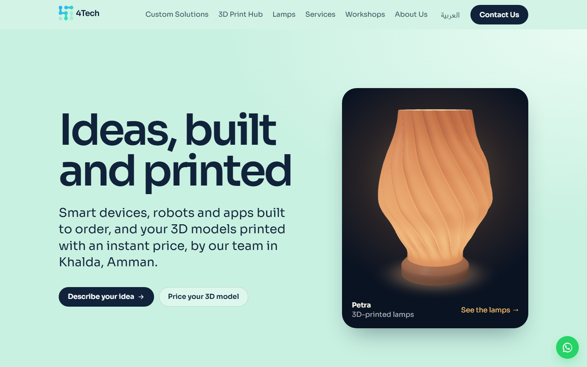
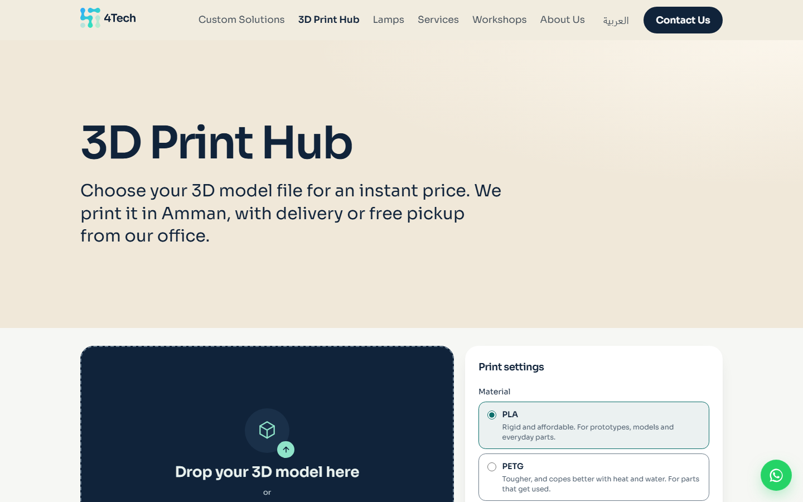
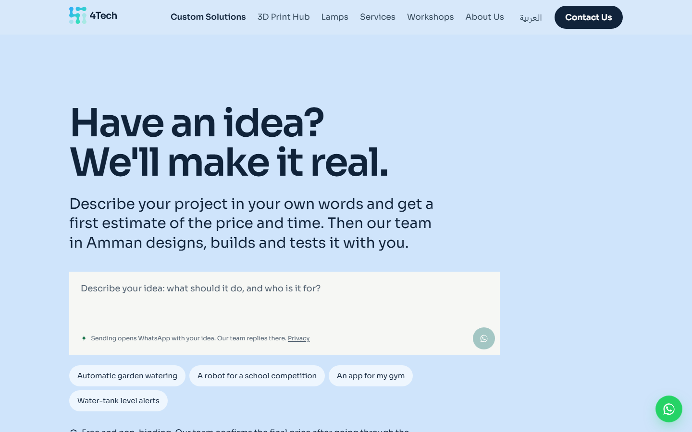
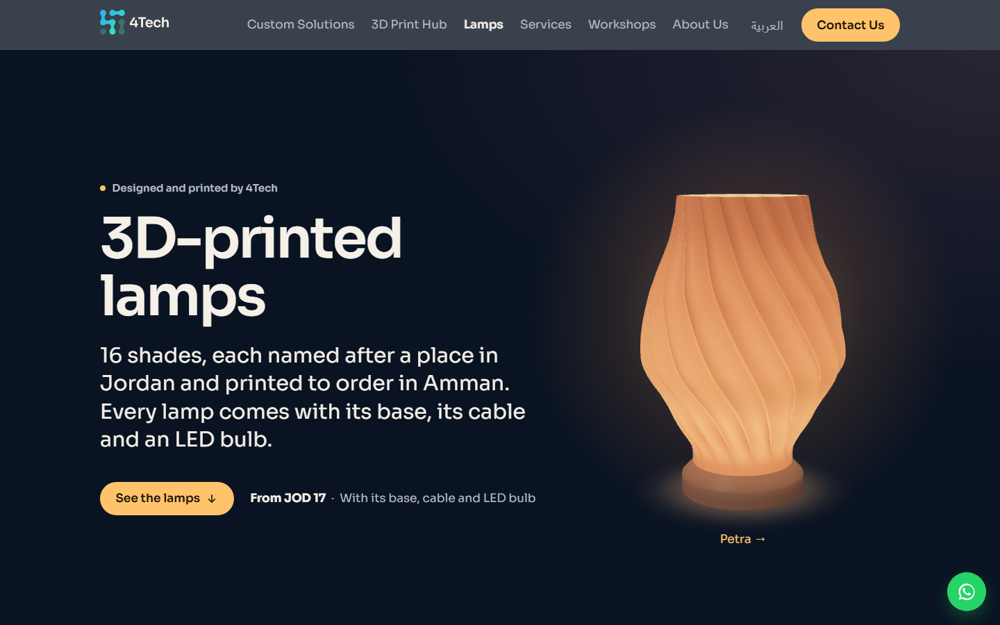
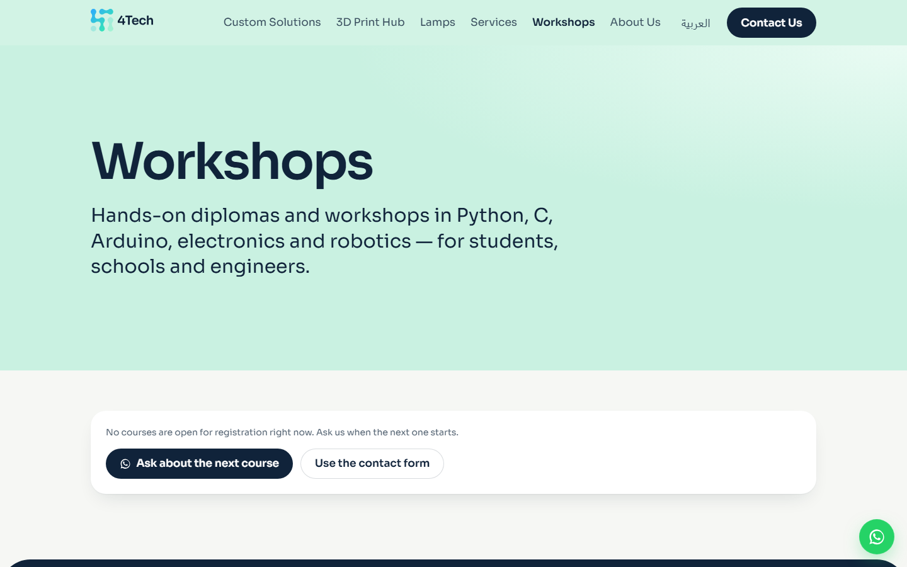
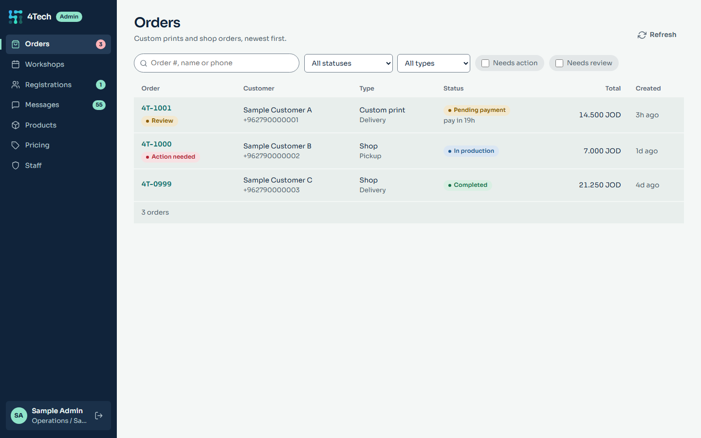
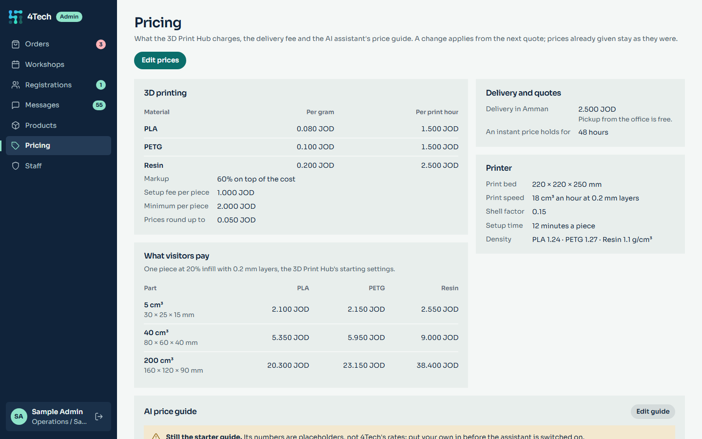
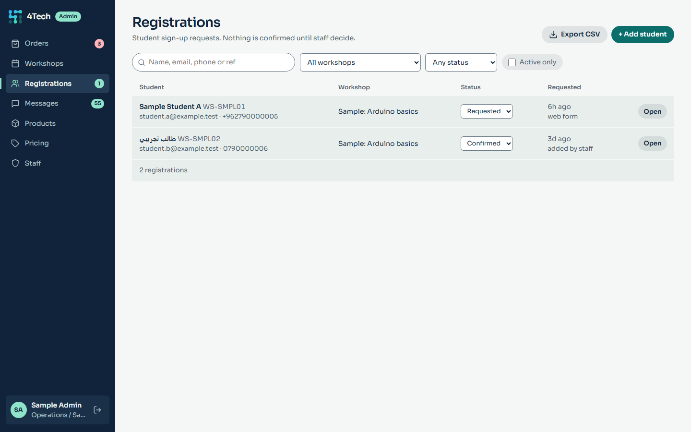
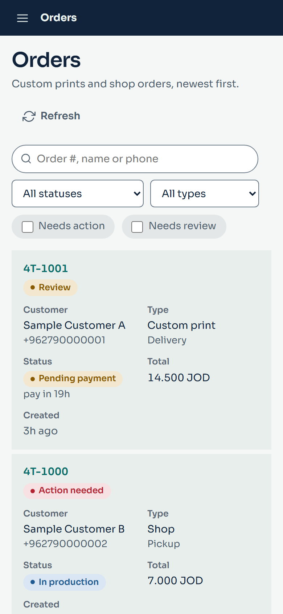

# The 4Tech website

[← Back to the overview](../README.md)

**Live:** [4thtechjo.com](https://4thtechjo.com) · **Built:** September to November 2026 ·
**My part:** everything (design, frontend, backend, admin panel, deployment)

A company website that also does work: it prices a 3D print the moment a visitor drops a
model on the page, an AI assistant turns a project idea into a first price offer, and staff
run orders, workshops and prices from their own admin panel. It is in English and Arabic,
and it is sized to run on one small server.

## What it's made of

| Part | What | Built with |
|---|---|---|
| Public site | Static pages in English and Arabic (right to left) | Astro 5, TypeScript, Tailwind v4 |
| API | Store, instant quotes, workshops, contact form, the AI assistant, the staff API | FastAPI, async SQLAlchemy, Postgres |
| Admin panel | Staff screens, in its own container on its own hostname | Plain HTML, CSS and ES modules, no build step |
| Proxy | Two virtual hosts, one for the public and one for staff | nginx |

The backend has 240 automated tests: pricing, the order state machine, the admin API,
workshops, the assistant, and a regression test for each bug found in the site reviews.

## Features

### Instant 3D-print pricing, with no load on the server

A visitor drops an STL or OBJ file on the page. The browser reads the model in a Web Worker,
shows it in a WebGL preview written without a library, and sends only the numbers (volume,
size, triangle count) to the server. The server prices it and returns a quote. The server
never touches the file.

Staff set every number behind the price (cost per gram and per print hour for each material,
markup, setup fee, minimum, rounding) in the admin panel. Each save is kept as a new version,
and every quote stores the prices it was made with.

### An AI assistant that makes a first price offer

On the Custom Solutions page a visitor describes an idea. The assistant asks the two or
three questions that matter for the price, then gives an offer card: a price range, the time
to build it, what the price covers and what it assumes, and a button that sends the whole
offer to the team on WhatsApp.

- The assistant does not write prices into its text. It calls a `price_offer` tool, and the
  backend checks what it sent before the page draws the card, so a visitor never sees a
  half-written or garbled price.
- Prices come only from a price guide that staff edit in the admin panel. No deploy needed.
- It runs on Claude Haiku with the prompt cached, so an answer costs well under a tenth of
  a US cent. There are limits per visitor and per day for the whole site.
- If the assistant can't answer (no credit, daily cap reached, an error), the visitor gets
  a short note and the WhatsApp button. Nothing breaks.
- The chat box follows current chat interface patterns (streaming, Stop, Copy, Try again,
  Edit) and is written without React, to keep the page's script small.

### Lamps drawn live in 3D

4Tech sells its own 3D-printed table lamps. A lamp on the site is a recipe (a height, a
silhouette and a pattern), not an image file. From that one entry the site draws the lamp
in WebGL, a script exports the printer's file, and another script checks that the shade
fits the print bed, clears the bulb and can be printed, then reports its weight, print
time, cost and margin. So the picture on the site is the thing that gets printed.

### English and Arabic

| English | Arabic |
|---|---|
|  |  |

Every page exists in both languages with a right-to-left layout for Arabic. Every editable
field in the database has an English and an Arabic column, and the WhatsApp messages staff
send are written in the customer's language.

### Workshops and course certificates

Staff publish courses; students register interest; staff confirm, waitlist or decline, each
with a one-click WhatsApp message. Graduates get a print-ready certificate with a QR code
that opens the certificate's own page on the site, so anyone can check that it's genuine.

### The staff admin panel

| Orders | Pricing |
|---|---|
|  |  |

| Registrations | On a phone |
|---|---|
|  |  |

*The screenshots show made-up sample data.*

Nine screens (orders, workshops, registrations, messages, products, pricing, content,
videos, staff), each open only to the roles that need it. The panel is a single-page app
with no framework and no build step, served from a container that uses about 5 MB of RAM.

- Three staff roles. The server checks every action; the panel only hides what a role can't
  use.
- Orders follow a state machine: the panel offers only the next steps that are valid for
  this order and this role.
- When a session expires, staff sign back in over the page they were on, and an open form
  keeps what was typed.
- It works on a phone: tables become cards.

## Design decisions

- **The public site and the admin panel are separate.** The panel has its own container and
  its own hostname. On the public hostname, the panel, the staff API and the sign-in
  endpoints all answer 404. Staff can then be firewalled or put behind a VPN by restricting
  one hostname.
- **No tokens in the browser.** Passwords are hashed with Argon2id. Sessions live in
  Postgres and the browser holds only an `HttpOnly` cookie. Every change by staff must
  carry a custom header, so another website can't make a signed-in browser do anything.
- **The specification contradicted itself, so I wrote the decisions down.** I found 18
  contradictions and gaps in the product requirements (for example: "never trust a price
  from the browser", when the volume the price is computed from comes from the browser).
  Each one has a documented decision in the project's README, and each is reversible.
- **A deploy that checks itself.** The deploy script backs up the database, runs migrations,
  switches to the new version, tests the site, the admin panel and the API through the
  proxy, and rolls back by itself if any test fails.

## Reviews I ran on my own work

I audited the site three times and fixed what I found:

- **September 2026, site audit:** broken behavior, performance, and wording that read as
  machine-written.
- **October 2026, site review:** visitor-facing bugs, SEO, backend, security, the admin
  panel, operations.
- **October 2026, UI/UX review:** every page, the forms, navigation, mobile, and the copy.

Several entries in [problems-solved.md](../problems-solved.md) came out of these.
